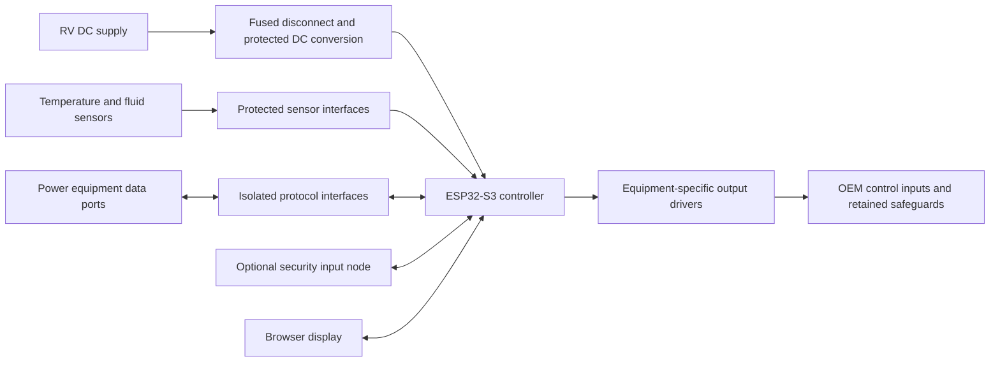

# DIY RV PRO installation manual

Engineering edition - 2026-09-30. Physical installation is not released yet.
The current firmware supplies simulated telemetry and simulated controls.
These instructions cover verified build steps and the installation information
being established. Terminal-level harness drawings and actual-board photographs
remain required before this manual can be used for an installed control system.

## 1. Record the installation

Create an equipment schedule before ordering parts. For each item record its
location, manufacturer/model, supply voltage, interface, required measurement,
control authority and existing manual control. Use the IDs in
[the BOM](BILL_OF_MATERIALS.md) to record the parts needed for each connection.

Include every HVAC zone and its heating/cooling/fan equipment; every battery,
inverter, charger, solar controller and monitored circuit; generator model and
remote-control specification; tank type/capacity/sender; water-heater type,
heating sources, native controls and recirculation; pump, temperature and
optional security points. Record monitor-only equipment explicitly.

## 2. System layout

The following is an architecture diagram, not a terminal wiring diagram.

Do not connect raw RV supply, mains voltage, relay coils or an unspecified
sensor output to ESP32 GPIO. Separate power wiring from low-level measurement
wiring. Keep equipment safeguards and manual operation available independently
of this controller. Mains, generator and fuel-system work requires the relevant
qualifications and exact equipment instructions.

## 3. Build and bench preparation

1. Confirm the board marking. The current build targets ESP32-S3-DevKitC-1-N8.
   Different flash/PSRAM or Ethernet boards require matching board profiles.
2. Leave equipment control wiring disconnected. Use the board manufacturer's
   approved USB power/data connection for development.
3. From `frontend`, run `npm ci`, `npm test`, then `npm run build`.
4. From the repository root on Windows run `./scripts/pio.ps1`, followed by
   `./scripts/test-firmware.ps1` when Visual Studio C++ Build Tools are installed.
5. Run `./scripts/pio.ps1 run --target buildfs` to create the dashboard image.
6. With the correct board connected, firmware upload is
   `./scripts/pio.ps1 run --target upload --upload-port COMx`; dashboard upload is
   `./scripts/pio.ps1 run --target uploadfs --upload-port COMx`. Replace COMx with
   the verified board port. These commands change the board's stored images.
7. Read boot output using `./scripts/pio.ps1 device monitor --port COMx`.

Build and host-test commands have been exercised on the development PC. Upload,
boot and physical I/O commissioning still require bench verification.

## 4. Sensor wiring sheets required for release

Each released sheet must include a board photograph with connector orientation,
terminal identifiers, source datasheet revision, supply and logic voltage,
protection circuit, cable specification and commissioning measurements.

| Sheet | Required connections and checks |
| --- | --- |
| W-01 Protected controller power | Supply/fuse/disconnect/DC converter/return; reverse polarity and brownout tests |
| W-02 DS18B20 bus | VDD/GND/DQ, pull-up, protection and sensor identities; cable/topology and CRC tests |
| W-03 Resistive tank sender | Excitation/reference, ADC and return; empty/full/intermediate calibration and open/short detection |
| W-04 Voltage/current-loop sender | Receiver/protection/isolation; supply, signal range, fault indication and calibration |
| W-05 Digital equipment bus | Exact transceiver, connector, polarity, termination, addressing and protocol mapping |
| W-06 HVAC harness | Model-specific thermostat/control interface; relay defaults, equipment limits and feedback |
| W-07 Generator harness | Model-specific start/stop/run feedback, timing and physical stop procedure |
| W-08 Heater/pump harness | OEM enable inputs, rated output stage, thermal/flow safeguards and manual override |
| W-09 Optional security node | Power/network/contact/tamper terminals; supervised-loop variant and disconnect tests; [W-09A](WIRING_SECURITY_CONTACT_BENCH.md) documents the local bench contact prototype only |

These sheets are pending, not implied by the architecture diagram. Probe wire
colors, relay-board labels and nominal sensor ranges are not sufficient evidence
for a wiring assignment. No final pin allocation has been released.

## 5. Commissioning sequence required before enabling control

1. Verify supply voltages, grounding/isolation and each circuit against its sheet.
2. Enroll the controller and optional modules with verified device identities.
3. Select installed equipment and driver; map every reading to a sensor identity
   or device address/channel, rather than relying on enumeration order.
4. Check raw readings, units and calibration against a known reference.
5. Disconnect each sensor in turn and confirm a fault, not a plausible reading.
6. With loads isolated or using test indicators, verify output mapping, polarity
   and de-energized behavior during boot, reset and power interruption.
7. Verify equipment-specific timing, feedback, stop conditions and overrides.
8. Enable equipment one subsystem at a time. Test automation only after manual
   commands and interlocks have passed.
9. Export the final configuration and retain the wiring schedule, serial numbers,
   firmware versions, calibration record and signed commissioning results.

The current configuration editor does not yet implement this complete sequence.
Saving a profile is not a commissioning certificate or proof of actual operation.

## 6. Later expansion

Back up the installation before adding a module. Assign a unique identity,
authenticate enrollment and test only the new/affected points before enabling
them. A lost optional security node must be visible as offline, and must not
silently disable unrelated climate or water operation. This workflow remains
under implementation.

## 7. Troubleshooting the development build

| Symptom | Check |
| --- | --- |
| Whitespace error from PlatformIO | Use `scripts/pio.ps1`; it verifies the no-space junction |
| First build takes several minutes | Let SDK setup/compilation finish; inspect progress rather than assuming a hang |
| Dashboard assets missing | Build frontend, build SPIFFS, then upload filesystem to the intended board |
| Saved configuration does not affect readings | Current telemetry is simulated; drivers are not yet connected |
| Demo configuration update message | Development session only; not persistent controller storage. Production saves require authentication and acknowledgement |
| Generator/HVAC controls animate but equipment does not change | Current commands are simulated; do not troubleshoot by bypassing equipment protection |
